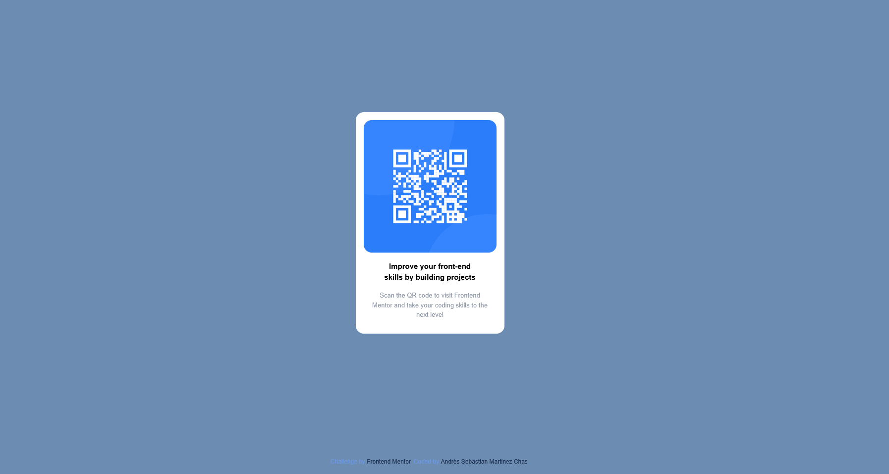

# Frontend Mentor - QR code component solution

This is a solution to the [QR code component challenge on Frontend Mentor](https://www.frontendmentor.io/challenges/qr-code-component-iux_sIO_H). Frontend Mentor challenges help you improve your coding skills by building realistic projects. 

## Screenshot





## Links

- [Solution URL](https://github.com/sebasmartinezchas/qr-code)
- [Live Site URL](https://sebasmartinezchas.github.io/qr-code)

## My Process

- The first thing I focused on was structuring and positioning the core layout elements. 
- Once the main structure was in place, I moved on to the finer details.


## Built with

- Semantic HTML5 markup
- Flexbox


## What I learned

- **Semantic HTML (`<main>` vs `<div>`):** I chose to use `<main>` instead of a generic `<div>` to improve accessibility and SEO, allowing screen readers and search engines to easily identify the primary content of the page.
- **Responsive Scaling (`min()`):** Using `min(100% - 2rem, 300px)` ensures the layout remains safe and readable on mobile devices by leaving a small margin, while preventing it from stretching past a clean, maximum width on larger desktop monitors.

```html
<main>Not everything needs to be a div</main>
```

```css
.container {
    width: min(100% - 2rem, 300px);
}
```

## Continued development

This is the first challenge of many. I hope to gain a level of CSS knowledge that allows me to build projects I'm excited about.


## Author

- Andres Sebastian Martinez Chas
- Frontend Mentor - [@sebasmartinezchas](https://www.frontendmentor.io/profile/sebasmartinezchas)
